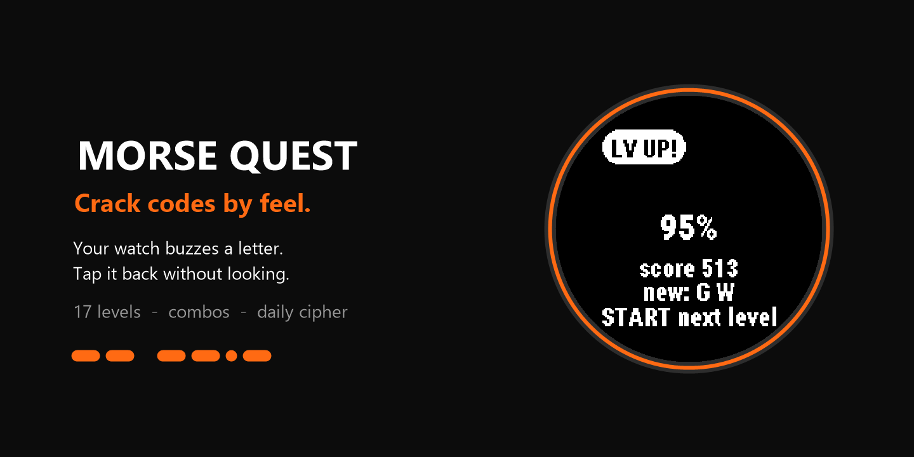

# Morse Quest

A Morse code game for Garmin watches that you play by feel. The watch vibrates a letter on your wrist; you tap it back with two buttons without looking at the screen. Get it right to level up, build combos and keep a daily streak.

Connect IQ Store: <https://apps.garmin.com/apps/1001dd4f-cb69-4892-8963-66f6555bc6c2>



Target device: Instinct 3 Solar 45 mm / 50 mm (`instinct3solar45mm`, 176x176 monochrome display with a round subscreen at the top right). Built with Connect IQ SDK 9.3.0.

## Modes

| Mode | What it does |
|---|---|
| Lesson | Single-letter drills. Starts with E T A N and adds two characters per level, 17 levels in total (A-Z and 0-9). A lesson is 20 letters; score 90% or more to unlock the next level. New letters and letters you often miss come up more often. Each lesson starts by showing and buzzing the new letters. |
| Words | 10 short words (SOS, RUN, GPS...) built only from letters you have unlocked. |
| Daily cipher | 5 words seeded by the date. One play per day; keeps a streak. |
| Buzz the time | Vibrates the current time in Morse. |
| Stats | Level, best scores and your weakest letters. |
| Settings | Letter speed 8/10/12/15 WPM, letter spacing (Farnsworth), vibration strength, sound (off / beep / morse), lesson level, reset progress. |
| How to play | Five help pages. |

## Controls

| Button | Action |
|---|---|
| UP | Dot |
| DOWN | Dash |
| Pause about 1 s | Next letter |
| START | Nothing entered yet: replay. Something entered: submit now. Intro: skip. Results: play again. |
| BACK | Back to the menu |

Why not hold START for a dash: on Instinct 3 the system takes over a long press of the GPS (START) button, so an app cannot time it. Using two buttons also keeps button timing out of the score, so it measures only whether you can tell dots from dashes on your wrist.

## Scoring

10 points per letter times a combo multiplier (plus 1 for every 5 correct answers in a row, up to x3). Starting your answer within 1.5 s of the buzz adds 5 points. A wrong answer gives one long, weak buzz and then buzzes the correct answer so you can feel it.

## Timing (Farnsworth)

Dot length = 1200 / WPM ms. Letters always play at the chosen speed; "Letter spacing" only stretches the gaps between letters and words (normal / wide / wider / widest = 1x / 1.5x / 2x / 3x). The default is 8 WPM with wider spacing. Tighten the spacing first as you improve, then raise the speed.

Every dot and dash is its own `vibrate()` call driven by a Timer, so the VibeProfile array never holds more than one entry (some devices cap it at about 8).

## Project layout

| Path | Contents |
|---|---|
| `source/Morse.mc` | Morse table, learning order, word list, vibration timing |
| `source/MorseGame.mc` | Game modes, scoring, level unlocks, daily streak |
| `source/MorsePlayer.mc` | Plays text as vibration, one symbol per timer tick |
| `source/MorseView.mc` | Game screens |
| `source/Menus.mc` | Main menu, settings, help and stats pages, debug test screens |
| `source/Ui.mc` | Drawing helpers: subscreen-aware centring, pills, progress bar, dot/dash graphics |
| `source/Settings.mc` | Stored settings and progress |
| `source/Feedback.mc` | Vibration and sound |
| `store-art/`, `store-screenshots/` | Store images |
| `tools/make-store-art.ps1` | Builds the store cover and hero images from the screenshots |

## Build

You need the Connect IQ SDK and a developer key.

```powershell
$sdk = "<path to your Connect IQ SDK>\bin"
$key = "<path to your developer_key.der>"
& "$sdk\monkeyc.bat" -f monkey.jungle -d instinct3solar45mm -o bin\MorseQuest.prg -y $key -r
& "$sdk\monkeyc.bat" -f monkey.jungle -e -o bin\MorseQuest.iq -y $key -r
```

The `.prg` is for side-loading onto a watch (`Garmin\Apps\`); the `.iq` is the store package.

**Debug builds** (without `-r`) add a "Test screens" item at the end of the main menu. It jumps straight to the level-up, fail, words, daily, already-done-today and time result screens using the real end-of-session logic (it writes progress), runs the cross-day streak checks, and sets up fixed states for store screenshots. That code is marked `(:debug)`, so release builds leave it out.

**Updating the app on a watch:** over MTP, copying a file does not replace one with the same name. Move the old `.prg` off the watch first, then copy the new one.

## Adding devices

The manifest currently lists only Instinct 3 Solar. To support more watches:

1. Download the device in the SDK Manager (Devices tab).
2. Add its id to `<iq:products>` in `manifest.xml`.
3. Check every screen in the simulator. The layout adapts to round or square screens, colour or monochrome, and screens with or without a subscreen.
4. Leave out touch-only watches: they have no UP/DOWN buttons.
